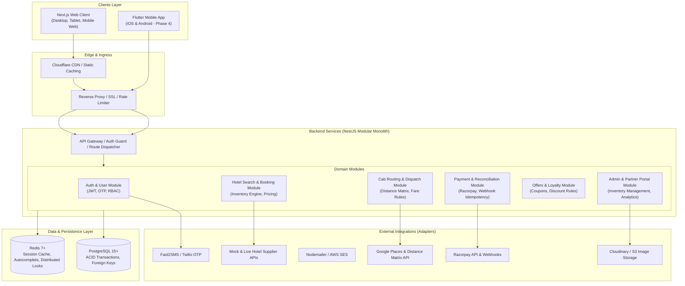

# SYSTEM ARCHITECTURE & TECHNICAL BLUEPRINT

---

### 1. High-Level Architecture Diagram



---

### 2. Frontend Architecture (Next.js & React)
- **Directory Structure**:
  ```text
  apps/web/
  ├── src/
  │   ├── app/                      # Next.js App Router
  │   │   ├── (auth)/               # Login / Register route group
  │   │   ├── hotels/               # Hotel routes: listing, detail, checkout, confirmation
  │   │   ├── cabs/                 # Cab routes: listing, checkout, confirmation
  │   │   ├── account/              # User account, bookings, profile
  │   │   ├── admin/                # Admin operations dashboard
  │   │   ├── layout.tsx            # Root layout with providers & global header
  │   │   └── page.tsx              # Homepage with MakeMyTrip hero search widget
  │   ├── components/               # Atomic Design System
  │   │   ├── ui/                   # Reusable base elements (Button, Input, Modal, Badge)
  │   │   ├── forms/                # Form controls with react-hook-form & Zod
  │   │   ├── layout/               # Header, Footer, Subnav, MobileNav
  │   │   ├── hotels/               # HotelSearchWidget, HotelCard, RoomMatrix, AmenitiesGrid
  │   │   └── cabs/                 # CabSearchWidget, CabCard, FareBreakdownDrawer
  │   ├── hooks/                    # Custom hooks (useHotelSearch, useDebounce, useAuth)
  │   ├── lib/                      # Utilities, API client, date formatters, currency
  │   ├── types/                    # TypeScript interfaces for API models & domain entities
  │   └── styles/                   # Design tokens, CSS variables, Tailwind configuration
  ```
- **State Management**:
  - URL query parameters (`searchParams`) for all filter, pagination, and search queries (ensuring shareable and reload-resilient states).
  - React Context for lightweight session, active currency, and modal dialog controllers.
  - TanStack Query (React Query) for server state caching, optimistic updates, and background re-fetching.

---

### 3. Backend Architecture (NestJS Modular Framework)
- **Directory Structure**:
  ```text
  apps/api/
  ├── src/
  │   ├── core/                     # Shared guards, interceptors, filters, decorators
  │   │   ├── guards/               # JwtAuthGuard, RolesGuard, RateLimitGuard
  │   │   ├── filters/              # GlobalExceptionFilter (RFC 7807 compliant)
  │   │   └── interceptors/         # LoggingInterceptor, TransformResponseInterceptor
  │   ├── modules/
  │   │   ├── auth/                 # AuthController, AuthService, OtpService, JwtStrategy
  │   │   ├── hotels/               # HotelController, HotelService, InventoryService
  │   │   ├── cabs/                 # CabController, CabService, PricingRuleEngine
  │   │   ├── bookings/             # BookingController, BookingService, StateMachine
  │   │   ├── payments/             # PaymentController, RazorpayService, WebhookService
  │   │   ├── promotions/           # PromotionController, CouponService
  │   │   └── admin/                # AdminController, PartnerService, ReportService
  │   ├── integrations/             # Adapter implementations (Mock vs Live)
  │   │   ├── maps/                 # GoogleMapsAdapter
  │   │   ├── payments/             # RazorpayAdapter
  │   │   └── suppliers/            # HotelSupplierMockAdapter
  │   ├── prisma/                   # Prisma schema, migrations, seeders
  │   ├── main.ts                   # Entrypoint with Swagger bootstrap & validation pipes
  │   └── app.module.ts             # Root module importing all feature modules
  ```

---

### 4. Database Architecture & Concurrency
- **Concurrency & Anti-Double-Booking**:
  - Redis distributed mutex (`redlock`) applied during checkout room reservation.
  - Database row-level locks (`SELECT ... FOR UPDATE`) in PostgreSQL transaction when confirming hotel room inventory.
  - Cab bookings use unique driver assignment state machine (`REQUESTED` -> `ASSIGNED` -> `STARTED` -> `COMPLETED`).
- **Idempotency**:
  - Every payment webhook and booking transaction requires an `Idempotency-Key` header or payment gateway transaction ID to guarantee zero duplicate charges.
