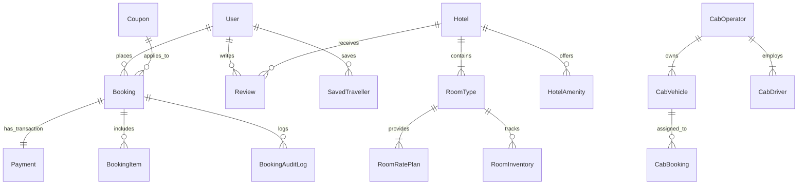

# DATABASE SCHEMA & ENTITY RELATIONSHIP SPECIFICATION

This document outlines the complete relational data schema for the travel booking platform (PostgreSQL 15+ managed via Prisma ORM).

---

### 1. Entity Relationship Diagram

---

### 2. Core Tables Specification

#### A. Users & Authentication (`users`)
| Column | Type | Constraints | Description |
|---|---|---|---|
| `id` | UUID | PRIMARY KEY, DEFAULT gen_random_uuid() | Unique user identifier |
| `phone_number` | VARCHAR(15) | UNIQUE, NOT NULL | Primary Indian mobile number (+91) |
| `email` | VARCHAR(255) | UNIQUE, NULLABLE | Optional verified email address |
| `password_hash` | VARCHAR(255) | NULLABLE | For password-based fallback auth |
| `first_name` | VARCHAR(100) | NOT NULL | User's first name |
| `last_name` | VARCHAR(100) | NULLABLE | User's last name |
| `role` | VARCHAR(20) | DEFAULT 'CUSTOMER' | 'CUSTOMER', 'ADMIN', 'PARTNER', 'OPERATOR' |
| `is_verified` | BOOLEAN | DEFAULT FALSE | Phone/OTP verification status |
| `created_at` | TIMESTAMPTZ | DEFAULT NOW() | Record creation timestamp |
| `updated_at` | TIMESTAMPTZ | DEFAULT NOW() | Last update timestamp |

#### B. Hotels & Inventory
- **`hotels`**: `id`, `name`, `slug`, `star_rating` (1-5), `property_type`, `city`, `state`, `address`, `latitude`, `longitude`, `check_in_time`, `check_out_time`, `thumbnail_url`, `images` (JSON array), `rules` (JSON array), `is_active`.
- **`room_types`**: `id`, `hotel_id` (FK), `name`, `description`, `max_adults`, `max_children`, `max_occupancy`, `base_price_per_night`, `area_sqft`, `bed_type`, `amenities` (JSON array), `images` (JSON array).
- **`room_rate_plans`**: `id`, `room_type_id` (FK), `name` (e.g., 'Room Only', 'Breakfast Included'), `price_multiplier`, `is_refundable`, `free_cancellation_hours_before_checkin`.
- **`room_inventories`**: `id`, `room_type_id` (FK), `date` (DATE), `total_rooms`, `booked_rooms`, `available_rooms`, `price_override` (NULLABLE).

#### C. Cabs & Fleet
- **`cab_categories`**: `id`, `code` (e.g., 'HATCHBACK', 'SEDAN', 'SUV', 'PREMIUM_SUV'), `title`, `example_models` (e.g. 'Dzire, Etios or similar'), `seat_capacity`, `luggage_capacity`, `ac_available`, `base_rate_per_km`.
- **`cab_pricing_rules`**: `id`, `trip_type` ('ONE_WAY', 'ROUND_TRIP', 'HOURLY_RENTAL', 'AIRPORT'), `cab_category_id` (FK), `base_km_included`, `base_hours_included`, `base_price`, `extra_km_rate`, `extra_hour_rate`, `driver_day_allowance`, `driver_night_allowance`.
- **`cab_vehicles`**: `id`, `operator_id` (FK), `category_id` (FK), `registration_number`, `model_name`, `color`, `puc_expiry`, `insurance_expiry`, `status` ('ACTIVE', 'MAINTENANCE', 'INACTIVE').
- **`cab_drivers`**: `id`, `operator_id` (FK), `name`, `phone_number`, `license_number`, `rating`, `is_active`.

#### D. Unified Bookings & Payments
- **`bookings`**:
  - `id`: UUID (PK)
  - `booking_reference`: VARCHAR(30) UNIQUE (e.g. 'MMT-HTL-20261101-9872', 'MMT-CAB-20261101-4412')
  - `user_id`: UUID (FK)
  - `category`: 'HOTEL' | 'CAB'
  - `status`: 'PENDING' | 'CONFIRMED' | 'COMPLETED' | 'CANCELLED' | 'REFUNDED'
  - `currency`: VARCHAR(3) DEFAULT 'INR'
  - `base_amount`: DECIMAL(10,2)
  - `taxes_and_fees`: DECIMAL(10,2)
  - `discount_amount`: DECIMAL(10,2)
  - `total_payable`: DECIMAL(10,2)
  - `cancellation_reason`: TEXT NULLABLE
  - `created_at`, `updated_at`
- **`hotel_booking_details`**: `id`, `booking_id` (FK), `hotel_id` (FK), `room_type_id` (FK), `rate_plan_id` (FK), `check_in_date`, `check_out_date`, `number_of_rooms`, `guests` (JSON array with names & ages), `special_requests`.
- **`cab_booking_details`**: `id`, `booking_id` (FK), `trip_type`, `pickup_address`, `drop_address`, `pickup_latitude`, `pickup_longitude`, `drop_latitude`, `drop_longitude`, `pickup_datetime`, `return_datetime`, `assigned_driver_id` (FK NULLABLE), `assigned_vehicle_id` (FK NULLABLE), `otp_start_trip`.
- **`payments`**:
  - `id`: UUID (PK)
  - `booking_id`: UUID (FK UNIQUE)
  - `gateway`: 'RAZORPAY'
  - `razorpay_order_id`: VARCHAR(100) UNIQUE
  - `razorpay_payment_id`: VARCHAR(100) UNIQUE NULLABLE
  - `razorpay_signature`: VARCHAR(255) NULLABLE
  - `status`: 'CREATED' | 'CAPTURED' | 'FAILED' | 'REFUNDED'
  - `amount`: DECIMAL(10,2)
  - `refund_amount`: DECIMAL(10,2) DEFAULT 0.00
  - `refund_id`: VARCHAR(100) NULLABLE
  - `idempotency_key`: VARCHAR(100) UNIQUE
  - `created_at`, `updated_at`

---

### 3. Database Indexes for High Throughput
- `CREATE INDEX idx_hotel_city_active ON hotels(city, is_active);`
- `CREATE INDEX idx_hotel_rating ON hotels(star_rating);`
- `CREATE INDEX idx_inventory_lookup ON room_inventories(room_type_id, date);`
- `CREATE INDEX idx_booking_user ON bookings(user_id, status);`
- `CREATE INDEX idx_booking_reference ON bookings(booking_reference);`
- `CREATE INDEX idx_payment_order ON payments(razorpay_order_id);`
