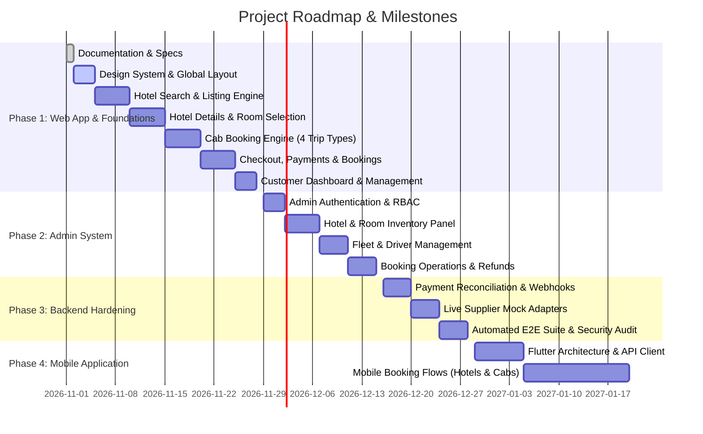

# PROJECT MASTER PLAN
## MakeMyTrip-Inspired Hotel & Cab Booking Platform (Brand: WanderStay / GoTrip)

---

### 1. Executive Summary & Vision
The goal of this project is to build an enterprise-grade, high-conversion travel booking platform inspired by MakeMyTrip (MMT). The system focuses on two core categories:
1. **Hotel Booking**: Domestic & international properties, real-time inventory validation, multi-room/guest search, rich media gallery, amenity filters, transparent price breakdowns (base fare, taxes, discounts), cancellation policies, and instant reservation vouchers.
2. **Cab Booking**: Outstation one-way, outstation round-trip, local hourly rental, and airport transfers with vehicle categories (Hatchback, Sedan, SUV, Premium SUV), distance/time-based fare estimation, toll/extra-km rules, and driver assignment lifecycle.

This platform adheres strictly to MMT's proven UX patterns: clean visual hierarchy, predictable tabbed search widgets, dynamic sticky search headers, faceted filtering, collapsible fare summaries, and unified checkout.

---

### 2. Engineering Team Roles & Governance
- **Principal Software Architect**: System topology, domain separation, API specifications, high-throughput caching, fault tolerance.
- **Senior UI/UX Designer**: MakeMyTrip design benchmarks, centralized design system, atomic components, micro-interactions, responsive layouts.
- **Senior Frontend Developer**: Next.js App Router, SSR/CSR balance, React Hook Form, Zod, TanStack Query, accessible ARIA components.
- **Senior Backend Developer**: Modular NestJS services, RESTful API conventions, rate limiting, distributed locking for inventory, webhook idempotency.
- **Database Architect**: PostgreSQL relational schemas, composite indexes, booking state machines, transactional integrity, audit logs.
- **QA Automation Engineer**: E2E test suites (Playwright), API unit/integration tests (Jest, Supertest), edge case matrices.
- **DevOps Engineer**: Docker containerization, CI/CD pipelines, Redis caching, environment secrets, health checks.
- **Security Engineer**: OWASP Top 10 compliance, payment webhook cryptographic signature verification, PCI-DSS compliance scope reduction, role-based authorization.
- **Product Manager**: Requirement traceability, milestone governance, progress reporting, release criteria.

---

### 3. Phased Roadmap

---

### 4. Technical Stack Decisions

| Layer | Selection | Justification |
|---|---|---|
| **Frontend Web** | Next.js 14+ (App Router), React 18+, TypeScript | High SEO performance for hotel pages, optimized asset handling, dynamic SSR/SSG. |
| **Styling & Design System** | Tailwind CSS + Custom CSS Design Tokens | MakeMyTrip red/blue palettes, fluid elevations, responsive grid, zero runtime CSS overhead. |
| **Backend API** | NestJS (Node.js & TypeScript) | Enterprise modular architecture, built-in validation pipes, Swagger/OpenAPI, dependency injection. |
| **Database & ORM** | PostgreSQL + Prisma ORM | ACID compliant transactions for booking allocations, migrations, strict schema definitions. |
| **Cache & In-Memory Store** | Redis | Ephemeral session stores, search auto-complete cache, inventory lock during checkout. |
| **Payments** | Razorpay (with Webhook Idempotency) | Standard Indian payment gateway supporting UPI, Cards, NetBanking, and automated refunds. |
| **Maps & Routing** | Google Maps Platform (Places Autocomplete, Distance Matrix, Directions API) | Accurate geocoding, driving distance calculations for outstation & local cab pricing. |
| **Notifications** | Nodemailer (SMTP/SES) + Firebase Cloud Messaging | Multi-channel booking confirmations, OTP delivery, trip status alerts. |

---

### 5. Dependency-Aware Milestones & Release Gates

1. **Gate 1: Master Specification & Documentation Sync**
   - All 14 master project markdown documents generated and cross-linked.
2. **Gate 2: Frontend Foundation & Design Tokens**
   - Brand color palette (`#008cff`, `#e41b23`, `#0f172a`), typography, shared buttons, inputs, date range pickers, modal dialogs, and navigation headers.
3. **Gate 3: MakeMyTrip Hotel Journey Milestone**
   - Homepage Search Widget -> Search Results with Faceted Filtering -> Hotel Details (Gallery & Amenities) -> Room Selection Table -> Checkout/Guest Form -> Mock/Live Payment Gateway -> Booking Confirmation & Voucher Download.
4. **Gate 4: MakeMyTrip Cab Journey Milestone**
   - 4-Tab Cab Search (Outstation One-Way, Round-Trip, Hourly Rental, Airport) -> Distance Matrix Calculation -> Vehicle Category Selection -> Fare Breakdown -> Pickup Details -> Checkout -> Driver Assignment State Machine.
5. **Gate 5: Administration & Partner Management**
   - Super Admin, Hotel Partner, and Fleet Operator consoles with inventory calendars, pricing override, booking override, and financial ledger.
6. **Gate 6: Testing, Security & Hardening**
   - 100% test scenario execution across hotel and cab workflows; load testing, webhook signature validation, XSS/SQLi sanitization.
7. **Gate 7: Mobile Readiness Handover**
   - Verified OpenAPI spec with zero client-specific coupled logic for future Flutter implementation.
